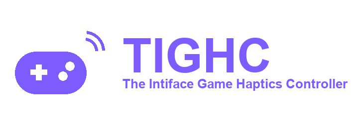

  

# Contributing to the TIGHC Website

Issues and pull requests are welcome at
[github.com/TIGHC/Website](https://github.com/TIGHC/Website).

## Getting set up

No build tooling required - plain HTML/CSS/JS. See the [README](README.md)
for the file structure and the
[Developer Guide](https://tighc.stuxie.dev/guides/developer) to preview
locally.

## Making a change

- Keep pages consistent with `style.css` - avoid inline styles or one-off
  CSS unless there's a good reason.
- If you add a page, link it from the nav and footer on every existing page
  (see how `index.html` and the others do it), including the
  `/legal` "Boring Legal Stuff" footer link.
- `profiles.js`, `changelogs.js`, and `versions.js` fetch live content from
  the [TIGHC/Profiles](https://github.com/TIGHC/Profiles) and
  [TIGHC/Engine](https://github.com/TIGHC/Engine) repos at runtime - test
  changes to them with `./dev-server.sh`/`dev-server.bat` (not `file://`),
  since `fetch` needs an HTTP origin.
- Check a narrow viewport if you touch layout (the site is responsive down
  to mobile widths). There's no light theme to check - the site is dark-only.
- Any new page needs OpenGraph/Twitter meta tags and a `<link rel="canonical">`
  in its `<head>` - copy the pattern from an existing page.

## Versioning

This project uses [Date Versioning](https://datevers.ing). To release:

1. Add a `## vYY.MM.DD` entry at the top of `CHANGELOG.md`, with its sections in this order: Added, Changed, Fixed, Removed, Security, Deprecated.
2. Set `VERSION.md` to the same bare version (no `v`): today's **UTC** date as `YY.MM.DD`, or `YY.MM.DD-1`, `-2`… for later releases the same UTC day. Never a future date. Use UTC, not local time: just after midnight in the UK it is still the previous day in UTC.
3. Run `bash tests/version.sh`.
4. Run `./commit.sh` (or `commit.bat` on Windows). It checks the version, commits and tags `vYY.MM.DD`, and never pushes.

## Discord preview and icons

Each page's `<head>` carries a Discord component embed. After adding a page or changing a page's title or description, run `python scripts/build-embeds.py` (the tests fail if it is out of date). A new page also needs the four icon tags (`/favicon.ico`, `/assets/icon-512.png`, `/apple-touch-icon.png`, `/site.webmanifest`) copied from any existing page.

## Sitemap

`sitemap.xml`, `sitemap/index.html` and `robots.txt` are generated: after adding or removing a public page, edit the `PAGES` list in `scripts/build-sitemap.py`, run `python scripts/build-sitemap.py`, and commit the result. `python -m unittest discover -s tests` checks them.

## Deploying

Merges to `main` publish automatically via GitHub Pages - no separate deploy
step. Don't remove the `CNAME` file unless the custom domain setup is
changing too. See the
[Install Guide](https://tighc.stuxie.dev/guides/install) for self-hosting
elsewhere.

## Reporting a bug

Open an issue with the page, browser, and what looked wrong (a screenshot
helps).
